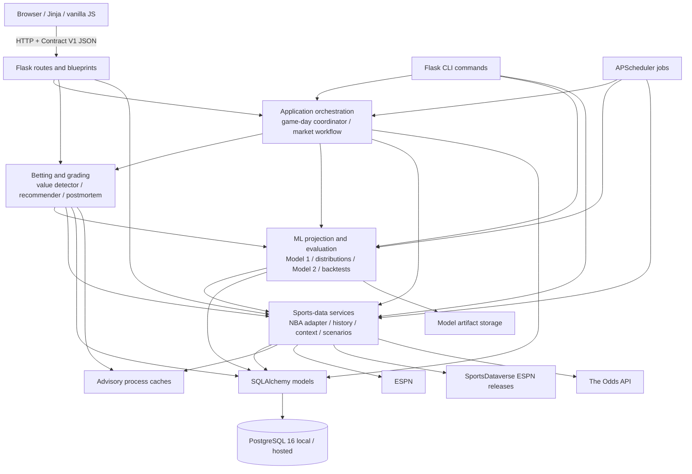

# Edge Tracker System Contract

Status: **canonical architecture SSOT**  
Contract version: **1.8**
Last verified: **2026-10-07**

Verified inventory at this version: **22 SQLAlchemy models**, **23 registered
APScheduler jobs**, and **NBA as the only registered `SportService`**.

This document is the single source of truth for module ownership, allowed
dependencies, cross-module data contracts, and state-management rules in Edge
Tracker. `ARCHITECTURE.md` remains a descriptive overview; when it disagrees
with this contract, this document wins.

Executable definitions remain authoritative for field-level implementation:

- database columns and relationships: `app/models.py` plus Alembic migrations;
- enum values: `app/enums.py`;
- Model 1 inputs: `app/services/ml_feature_builder.py::FEATURE_KEYS`;
- Model 1 load-time MAE limits: `app/services/ml_model.py::MAX_PROJECTION_MAE`;
- Model 2 inputs: `app/services/pick_quality_model.py::PICK_FEATURES`;
- per-sport historical stat keys: `app/services/sport_config.py`.

This file is the registry that assigns those owners and defines how they may
communicate. Do not create a second architecture or schema document that
competes with it. Proposed changes must update this file and the executable
owner in the same change.

Normative words `MUST`, `MUST NOT`, `SHOULD`, and `MAY` describe requirements.
Sections describing existing producers document current behavior. Forward rules
such as `ApiResultV1` apply immediately to new work; legacy deviations are
listed explicitly and may be migrated incrementally rather than assumed fixed.

## 1. Architecture decision

Edge Tracker is a **modular Flask monolith** with one relational database and
one deployable application unit. It is not a microservice system. Modules
are separated by responsibility so a boundary can be extracted later only if
independent scaling or deployment becomes necessary.

Core principles:

1. SQLAlchemy is the durable source of truth.
2. Routes, CLI commands, and scheduled jobs are entrypoints, not domain layers.
3. Business decisions live in services and policy modules.
4. Provider payloads are normalized before entering business logic.
5. Process-local caches are advisory accelerators and never correctness state.
6. Cross-module payloads use the versioned contracts in this document.
7. Game dates, slate boundaries, scheduler decisions, and freshness checks use
   `ZoneInfo("America/New_York")` (ET).
8. Model training and inference share executable feature contracts.

## 2. System and dependency map



The local runtime uses a project-scoped PostgreSQL 16 cluster started by
`scripts/local_postgres.sh`. SQLite remains a supported source for the guarded
`migrate-sqlite-to-postgres` CLI and an offline rollback image. Hosted
PostgreSQL uses the same Alembic model contract.

### 2.1 Dependency direction

The allowed direction is:

```text
browser/templates
    -> routes | CLI | scheduler
        -> orchestration and domain services
            -> lower-level services and policies
                -> ORM / model storage / provider adapters
```

| From | May depend on | Must not depend on |
|---|---|---|
| Templates/static JS | rendered data, documented HTTP contracts | Python modules, database layout |
| Routes | forms, contracts, services, ORM for simple user-scoped CRUD | CLI modules, scheduler registration, private functions in another route |
| CLI commands | contracts, services, ORM | routes, templates |
| Scheduler | orchestration functions and narrowly scoped jobs | routes, templates, browser state |
| Orchestration services | domain services, ORM, contracts | routes, CLI registration |
| Domain/ML services | lower services, ORM, contracts, provider adapters | routes, templates, CLI registration |
| Provider adapters | HTTP clients, provider parsing, contracts | routes and UI concerns |
| Models/enums | SQLAlchemy and pure utilities | routes, services, external APIs |

`app/routes/bet.py` is the blueprint composition module and MAY import route
handlers from the other bet route modules. All other shared behavior MUST live
in a service or pure utility; route modules MUST NOT import another route
module's private functions.

### 2.2 Module ownership map

| Capability | Canonical owner | Primary consumers | Contract exchanged |
|---|---|---|---|
| App construction and blueprint wiring | `app/__init__.py` | server and tests | configured Flask app |
| Authentication | `app/routes/auth.py`, Flask-Login | all protected routes | authenticated `current_user` |
| Bet CRUD and import | `app/routes/bet_crud.py`, `bet_import.py` | browser | `BetPlacementV1`, `ApiResultV1` |
| Shared basketball collection | `app/services/basketball_feed.py` | singleton scheduler | durable Games snapshot and revision journal |
| Basketball event delivery | `app/services/feed_stream.py`, `app/routes/live_feed.py` | `app/static/js/live_feed.js` | authenticated `ApiResultV1`, bounded SSE snapshot/reset/heartbeat |
| Source authorization | `app/services/provider_access.py` | provider adapters, release importers | fail-closed access decision; no secrets in status |
| Source availability presentation | `app/services/data_status.py` | authenticated templates | independent score-fetch and odds-configuration status |
| Guided prop quote evidence | `app/services/guided_quote.py` | prop JSON and record submission | user-bound signed source quote, durable latest observation |
| Recording retry receipts | `app/services/recording_idempotency.py` | record submission | per-user UUID + payload hash + atomic saved response |
| Game selection | `app/services/game_picker.py` | builder schedule endpoint | active aware-dated provider-namespaced events; BDL score-only has no odds link |
| Untrusted request normalization | `app/utils/request_validation.py` | placement and progress routes | validated finite, bounded payloads or explicit 400 |
| ESPN HTTP transport | `app/services/espn_client.py` | sports-data services | raw provider JSON or `EspnClientError` |
| NBA provider normalization | `app/services/nba_service.py` | routes, coordinator, grading | `GameV1`, `PropQuoteV1`, `LiveProgressV1` |
| Multi-sport interface | `app/services/base.py` | sport adapters | `SportService` plus boundary contracts |
| Historical stat catalogs | `app/services/sport_config.py` | importers, scenarios, ML | `SportStatConfig` |
| Historical ingestion | `espn_history_append.py`, `hoopr_import_service.py`, CLI adapters | coordinator, scheduler, ML | ORM rows |
| Scenario computation | `scenario_dimensions.py`, `scenario_engine.py` | `live_context`, `value_detector` | persisted scenario rows and context mapping |
| Projection | `projection_engine.py`, `ml_model.py` | `value_detector`, routes | `ProjectionV1` |
| Distributional probability | `distributional_*`, `distribution_calibration.py` | `value_detector`, backtest | probability details |
| Edge and pick scoring | `value_detector.py` | pages, recommender, pick context | `ScoredPropV1` |
| Market governance | `market_recommender.py` | scheduler, CLI, dashboard | market recommendation mappings |
| Pick-quality classifier | `pick_quality_model.py` | `value_detector`, CLI | Model 2 feature vector and probability |
| Daily auto-pick selection and persistence | `auto_pick_service.py` | scheduler, login hook | auto-generated `Bet` and `PickContext` rows |
| Pick-quality bootstrap examples | `pick_quality_bootstrap.py` | scheduler, CLI | synthetic resolved `Bet` and `PickContext` rows |
| Grading/postmortem | `nba_service.py`, `postmortem_service.py` | coordinator, routes | outcome tuple and ORM rows |
| Game-day orchestration | `game_day_coordinator.py` | scheduler | idempotent tier/result string |
| ML diagnostics and validation | `model_diagnostics.py`, `rolling_backtest.py` | CLI | `ModelEvaluationRun` |
| Shared scored-prop cache | `score_cache.py` | dashboard and analysis routes | `list[ScoredPropV1]` |
| Durable data | `app/models.py`, migrations | all server-side modules | SQLAlchemy entities |
| Artifact persistence | `model_storage.py` | ML services | artifact reference/path |

## 3. Shared schema registry

### 3.1 Persistent schemas

`app/models.py` and the migration chain are authoritative for the 22 current
SQLAlchemy models:

| Category | Models |
|---|---|
| Identity and betting | `User`, `PlayerIdentity`, `Bet`, `PickContext`, `BetPostmortem` |
| Guided recording evidence | `GuidedQuote`, `BetRecordingRequest` |
| Shared basketball feed | `BasketballFeedState`, `BasketballFeedEvent` |
| Live and historical sports data | `GameSnapshot`, `PlayerGameLog`, `HistoricalGameLog`, `HistoricalGameOdds`, `OddsSnapshot`, `TeamDefenseSnapshot`, `InjuryReport` |
| Scenario data | `ScenarioSplit`, `ScenarioContextPack` |
| ML and operations | `ModelMetadata`, `ModelEvaluationRun`, `JobLog`, `DataFetchReceipt` |

Rules:

- Schema changes MUST use an Alembic migration.
- A migration and its ORM change MUST ship together.
- JSON columns MUST have an owning schema in this registry or in the executable
  owner named here; they are not unstructured dumping grounds.
- Consumers MUST use canonical field names. Examples: `Bet.outcome`,
  `Bet.prop_line`, `PlayerGameLog.win_loss`.
- Identifiers from different providers MUST retain their namespace. Do not
  silently treat an ESPN player/event ID as an Odds API ID. Odds-only upcoming
  games keep `espn_id` empty and retain `odds_event_id`; the picker uses a
  namespaced `selection_key`. Missing/naive/out-of-window upcoming start times
  are omitted; valid start times are converted to ET before deriving the date.
- `PlayerIdentity.espn_id` is the permanent-history namespace. `nba_id` is
  nullable until an exact, reviewed crosswalk is available. Duplicate names
  remain ambiguous; fuzzy name similarity is never evidence for an automatic
  pick. Completed-game refresh and release reconciliation update the identity
  index when new history arrives.
- `TeamDefenseSnapshot.snapshot_date` is the calculation date, while
  `observed_through` is the last completed game behind the values. A prior
  season is labeled as such; synthetic estimates are not persisted as fresh
  snapshots. Positional allowances remain null unless observed.
- `InjuryReport.date_reported` retains the source report date. A successful
  zero-row `DataFetchReceipt` verifies an empty report; a failed fetch never
  carries old injury designations forward as current.

### 3.2 Enums and controlled vocabularies

| Vocabulary | Executable owner |
|---|---|
| Bet outcome, type, source, postmortem reasons | `app/enums.py` |
| Model 1 feature order | `ml_feature_builder.FEATURE_KEYS` (30 keys) |
| Model 1 load-time accuracy limits | `ml_model.MAX_PROJECTION_MAE` |
| Model 2 numerical feature order | `pick_quality_model.PICK_FEATURES` (17 keys plus encoded categorical values) |
| Per-sport historical stats | `sport_config.SPORT_STAT_CONFIG` |
| Supported NBA prop markets | `nba_service.SUPPORTED_PROP_MARKETS` |

Never duplicate these values as a second Python list. UI display labels MAY map
them to human-readable text but MUST preserve the canonical machine value.

### 3.3 Boundary-contract rules

- Contract names end in `V1` in this document even while runtime values remain
  Python dictionaries.
- Required fields MUST always be present. Optional fields use `null` at JSON
  boundaries; provider adapters may accept legacy empty strings but SHOULD
  normalize them before business logic.
- Unknown additive fields MUST be ignored by readers.
- Removing, renaming, or changing the meaning/type of a field requires a new
  contract version and a coordinated producer/consumer migration.
- Money values are decimal concepts. Existing floats remain supported, but new
  calculations MUST round only at presentation or settlement boundaries.
- Probabilities are floats in `[0, 1]`; displayed percentages are UI concerns.
- American odds are integers and cannot be zero when a real price is claimed.

### 3.4 `GameV1`

Produced by `nba_service.get_todays_games()` and consumed by live/analysis
routes, scoring, and the coordinator.

| Field | Type | Required | Meaning |
|---|---|---:|---|
| `espn_id` | string | yes | ESPN event identity |
| `name` | string | yes | provider matchup label |
| `home` / `away` | `TeamV1` | yes | competitors |
| `total_score` | integer | yes | current combined score |
| `status` | string | yes | provider status code |
| `status_detail` | string | yes | human status text |
| `clock` | string | yes | display clock or empty pregame/final |
| `period` | integer | yes | current period; `0` pregame |
| `start_time` | ISO-8601 string | yes | provider event timestamp |
| `season_type` | integer or null | yes | provider season type |
| `odds_event_id` | string | yes | Odds API event identity, empty if unmatched |
| `selection_key` | string | upcoming/picker payloads | namespaced advisory browser identity (`espn:` or `odds_api:`); never persisted as an ESPN ID |
| `over_under_line` | float or null | yes | current total |
| `moneyline_home` / `moneyline_away` | integer or null | yes | American price |
| `spread` | float or null | yes | normalized spread |
| `favored_side` | string or null | yes | normalized favorite |

`TeamV1` fields are `name: string`, `abbr: string`, `score: integer`, and
`logo: string`.

### 3.5 `PropQuoteV1`

Produced by `nba_service.fetch_player_props_for_event()`. The outer mapping is
`market_key -> list[PropQuoteV1]`.

| Field | Type | Required | Meaning |
|---|---|---:|---|
| `player` | string | yes | provider display name |
| `line` | float | yes | consensus line used for comparison |
| `over_odds` / `under_odds` | integer | yes | best same-line American odds; `0` means unavailable in legacy payloads |
| `books` | mapping | yes | bookmaker -> `{line, over_odds, under_odds}` |
| `best_over_book` / `best_under_book` | string | yes | source of selected price |
| `source_last_update` | aware ISO-8601 string or null | yes | oldest update among contributing bookmaker markets; null is unverifiable |

Persisted historical or live quote identity is owned by `OddsSnapshot` and
MUST include event, player, market, bookmaker, snapshot kind, observation time,
event start time, line, price, and the idempotency/source key. Live capture uses
a deterministic SHA-256 identity of the provider observation, event, player,
market, bookmaker, kind and price. Retries use database uniqueness and nested
savepoints. Missing, naive, future or expired provider timestamps cannot become
current live snapshots; `snapped_at` remains actual capture time.

### 3.6 `ProjectionV1`

Produced by `ProjectionEngine.project_stat()`.

Required stable fields:

```text
projection: float
std_dev: float
games_played: integer
confidence: string
projection_source: "heuristic" | "distributional" | string
z_score: float
context_notes: list[string]
breakdown: mapping
```

Training and inference MUST construct inputs through the canonical feature
builder. A caller MUST NOT manually assemble a Model 1 vector.
Historical point and distributional training MUST derive opponent-defense
features from completed games preceding the predicted game. A current
`TeamDefenseSnapshot` cannot be applied to historical training rows. Live
inference continues to use the most recent verified snapshot, with its
`observed_through` date exposed to analysis.
Historical closing game totals lack a verified decision-time capture and MUST
be zero in training rows until timestamped pre-decision totals are available.
Distributional heads trained before this context version MUST also be held
from inference.
Model 1's early-stopping rows MUST be inside the training period, leaving the
later validation period untouched by fitting. Inference MUST fall back unless
an active artifact declares the current historical-context version, has at
least 100 later validation rows split by game date, beats the recent-five-game
baseline on those rows, and meets its stat-specific MAE limit.
Retraining stores a failed candidate as inactive and preserves the prior
active artifact with a distinct per-run file; loading still applies this gate
to any older active artifact.
The production-readiness command reports the same inference gate, even when
an old database row still has `is_active=true`.

### 3.7 `ScoredPropV1`

Produced by `ValueDetector.score_prop()` and cached by `score_cache.py`.

```text
player: string
prop_type: string
line: float
projection: float
edge: float
edge_over: float
edge_under: float
recommended_side: "over" | "under"
recommended_odds: integer
confidence_tier: "strong" | "moderate" | "slight" | "no_edge"
model_prob_over: float
model_prob_under: float
book_prob_over: float
book_prob_under: float
context_notes: list[string]
std_dev: float
z_score: float
games_played: integer
confidence: string
projection_source: string
scenario_agreement: float | null
scenario_matches: integer | null
breakdown: mapping
game_id: string
win_probability: float | null
pick_quality_recommendation: string
```

Current daily scoring and actionable selections MUST carry an `odds_api`
quote with an aware source timestamp aged 0–10 minutes. Every cache read and
actionable filter rechecks that age. Historical `GameSnapshot` fallback MUST
NOT populate the current scoring or bet-builder market board. Recorded manual
prices are user observations and are not refreshed from provider data.

The no-data path includes `win_probability=null` and
`pick_quality_recommendation="no_model"`. Consumers MUST also interpret missing
keys in legacy cached mappings using those same defaults. An unavailable
classifier result is not a negative recommendation.
The stat-analysis page may add view-only matchup context to a copy of this
mapping. Team allowances must be labeled as team-wide, with sample size,
source, and observation date; prior player-opponent results must include their
sample size. These additions do not enter `ScoredPropV1`, the shared cache,
or automatic-pick scoring.

### 3.8 `BetPlacementV1`

Browser request for `/nba/place-bets` and equivalent placement flows:

```text
legs: list[BetLegV1]              required, non-empty
stake: float                      required, > 0
units: float | null               optional, > 0 when present
is_parlay: boolean                required
bonus_multiplier: float           optional, >= 1.0
round_robin: {size: integer} | null
```

`BetLegV1`:

```text
game_id: string
team_a: string
team_b: string
match_date: YYYY-MM-DD
bet_type: value from BetType
american_odds: integer | null
player_name: string | null
prop_type: string | null
prop_line: float | null
over_under_line: float | null
picked_team: string | null
```

Server-owned fields such as `user_id`, `outcome`, `source`, `parlay_id`, and
`parlay_group_id` MUST NOT be trusted from the browser.

The current endpoint defaults `is_parlay` to false and falls back when
`match_date` is absent or invalid. That is legacy tolerance, not permission for
new producers to omit the required V1 fields.

The session-storage queue uses key `sbt_parlay_queue_v1` and stores
`list[BetLegV1]`. A breaking change requires a new storage key and migration or
safe reset logic.

### 3.9 `LiveProgressV1`

Produced by `nba_service.resolve_card_progress()`:

```text
ok: boolean
player: string                     when ok
prop_type: string                  when ok
bet_type: "over" | "under"        when ok
current_stat: float               when ok
stat: float                       legacy alias of current_stat
line: float                       when ok
period: integer                   when ok
clock: string                     when ok
game_state: "pregame" | "live" | "halftime" | "final"
projected_final: float            when ok
status_text: string               when ok
elapsed_ratio: float              when ok
progress_pct: float               when ok
delta_to_line: float              when ok
on_track: boolean | null          when ok
match_score: float                when ok
error: string                     when not ok
retryable: boolean                transient unavailable/deferred responses
status: string                    distinguishes deferred from terminal failure
```

UI implementations MUST preserve the definition-of-done fields: current stat,
line, period, clock, game state, projection, and trend. In the current contract,
the projection is `projected_final`; the UI derives trend semantics from
`on_track`, `delta_to_line`, and `bet_type` rather than receiving a field named
`trend`.

### 3.10 `ApiResultV1`

New JSON endpoints MUST use one envelope:

```json
{
  "ok": true,
  "data": {},
  "error": null,
  "meta": {}
}
```

or on failure:

```json
{
  "ok": false,
  "data": null,
  "error": {"code": "stable_machine_code", "message": "Human-readable message", "details": {}},
  "meta": {}
}
```

Existing endpoints using `success`, `message`, or a string-valued `error` are
legacy-compatible. Do not introduce another envelope. Migrate legacy endpoints
only with their JavaScript consumers and tests in the same change.

## 4. State-management contract

### 4.1 State ownership table

| State | Source of truth | Lifetime/scope | Writer | Invalidation/recovery |
|---|---|---|---|---|
| Users, bets, contexts, postmortems | SQLAlchemy DB | durable | authenticated routes and grading services | transaction rollback; migrations |
| Game/player history and snapshots | SQLAlchemy DB | durable | provider ingestion and coordinator | freshness rules; idempotent upsert |
| Player identity and source receipts | SQLAlchemy DB | durable | identity sync and provider adapters | exact IDs, source timestamps, unresolved states |
| Odds decisions and closes | `OddsSnapshot` | durable | scheduled capture/import CLI | source key uniqueness and coverage checks |
| Scenario splits/context pack | SQLAlchemy DB | rebuildable derived state | scenario engine | atomic rebuild, then crosswalk cache clear |
| Model registry/evaluations | `ModelMetadata`, `ModelEvaluationRun` | durable | ML training/evaluation | new run/activation decision |
| Model binaries | `model_storage.py` | durable local artifact in current runtime | ML trainers | metadata reference; retrain to regenerate |
| Authentication | Flask-Login signed session | 30-minute sliding idle / 12-hour absolute; 14-day remember cookie | auth routes | logout/session expiry; see `docs/security/browser-persistence.md` |
| Parlay composition | browser `sessionStorage` | tab/session | shared JS utilities | explicit clear or browser session end |
| Today's scored props | `score_cache._cache`, guarded by `RLock` | process, ET day, 5-minute TTL; failure retry 30s | scoring service | original success age retained; stale fallback <=10m and quote age rechecked; midnight invalidates |
| NBA games/provider payload | `nba_service` caches | process, ET day, 60-second TTL | NBA adapter | failures never cache empty; date rollover; deep-copy props; expired entries pruned |
| Scoreboard availability | `nba_service._SCOREBOARD_STATUS`, locked | process, ET day; current <=60s | scoreboard adapter | last attempt/success distinct; errors retain success timestamp; date rollover |
| Live progress/summary | `nba_live` caches | process, 30-second TTL | live route | TTL and bounded pruning |
| Team defense lookup | `matchup_service` cache | process, 1-hour TTL | matchup service | explicit invalidation after refresh |
| Coordinator cheap-exit state | `_DAY_CACHE` | process/ET day; empty or done rechecked after15m | game-day coordinator | failed reads retry next tick; ET rollover/restart; DB remains truth |
| Projection scan/player state | `ProjectionEngine` instance | one engine/scan | projection engine | discard instance |
| Player crosswalk | `lru_cache` | process | crosswalk resolver | clear after scenario-pack rebuild |
| Job observability | `JobLog` | durable audit only | scheduled/CLI jobs | append/update; never use as an exclusive lock |

### 4.2 State rules

1. **Database before cache.** Correctness and idempotency MUST survive a process
   restart and multiple workers. If a decision matters after restart, persist it.
2. **Caches are per process.** A cache hit cannot prove another worker has the
   same state. Cache invalidation is a performance concern, not a transaction.
3. **Explicit ownership.** Every new mutable state object must be added to the
   table above with owner, lifetime, and invalidation.
4. **No hidden global workflow state.** Module globals MAY cache derived data;
   they MUST NOT be the only record that a bet was graded, quote captured, or
   model promoted.
5. **Transactions.** Entrypoints or named orchestration functions SHOULD own the
   transaction boundary. New leaf helpers MUST NOT commit unexpectedly. Existing
   service-level commits are legacy and must be documented by their function.
6. **Idempotent jobs.** Scheduler work MUST tolerate retries. Use database
   uniqueness/source keys and check persisted state before external writes.
7. **User isolation.** All user-owned reads and writes require `current_user.id`
   or an explicit trusted user ID; browser-supplied ownership is ignored. Routes
   that accept an object ID MUST scope the database query by both object ID and
   user ID, and MUST return the same 404 response for missing and foreign-owned
   objects.
8. **Frontend state is disposable.** The server validates all browser payloads.
   `sessionStorage`, DOM state, and JS globals are never authoritative.
9. **Artifact activation is explicit.** Evaluation verdicts do not auto-activate
   models; activation remains a separate controlled action.
10. **Authentication is bounded.** Authenticated sessions MUST have both an idle
    and absolute lifetime. Production session and remember cookies MUST be
    Secure, HttpOnly, and SameSite=Lax. Logout clears the current and legacy
    user-specific browser-storage keys listed in the persistence inventory.

### 4.3 Hosted process topology

- The web service runs one Gunicorn worker by default with
  `SCHEDULER_ENABLED=false`. This makes the process-local limiter and advisory
  caches internally consistent for the launch baseline.
- A web worker count above one requires a non-`memory://` shared limiter store;
  production startup fails closed when that contract is violated.
- Alembic runs as Railway's blocking pre-deploy command, never in each web
  container entrypoint. `AUTO_DB_UPGRADE` remains a local/manual escape hatch.
- Scheduler activation belongs to exactly one separately configured process.
  Provisioning and cross-container singleton proof remain deployment gates while
  hosting is inactive.

### 4.4 Provider and request failure policy

- ESPN HTTP and remote ESPN-derived releases are disabled outside tests unless
  both `ESPN_ACCESS_APPROVED=true` and `ESPN_RIGHTS_BASIS` are present. These
  settings record operator authorization; they do not grant data rights. Direct
  NBA Stats network entrypoints require distinct `NBA_ACCESS_APPROVED=true` and
  `NBA_RIGHTS_BASIS`; one provider's approval never authorizes another. Local
  file imports remain available. Provider status never exposes keys or basis text.
- Shared HTTP retry policy allows at most 3 attempts, 15s per attempt and 10s
  backoff. Retry only transport failures, 429 and 5xx; long Retry-After stops
  the call rather than retrying before the source allows. Count each attempt
  against the provider budget. Exceptions omit URLs and credentials.
- Live progress batches validate before any provider traffic: max 100 cards and
  15 unique games, unique bounded card IDs, bounded event/player/market fields,
  finite numeric values. Browser batches run sequentially and failed refreshes
  back off from 30s to 300s. Each progress read makes one attempt with a <=3s timeout. After a 12s batch
  budget, no additional reads start; unfinished cards return retryable/deferred
  and take priority on the next poll. Summary cache has at most 512 entries.
- Production refuses insecure session/remember cookie overrides. Private and
  authentication responses use `Cache-Control: private, no-store`.
- Provider pushes are not configured. The polling coordinator reconciles final
  games against durable state and runs internal grading/history workflows. A
  webhook receiver requires an authorized source, signatures and replay rules.

### 4.5 Shared basketball feed contract

- `BasketballFeedState` owns the `nba_games` snapshot, revision, last attempt,
  last success, retry deadline and failure count. `BasketballFeedEvent` owns
  ascending durable revision IDs and the latest 100 change payloads. Migration
  `ea7026bd109c` creates both; SQLite IDs are not recycled after journal pruning.
- `basketball_feed.collect_basketball_feed` runs every 30 seconds under the
  single scheduler owner. Absent `BALLDONTLIE_API_KEY` means disabled and no HTTP.
  One request has a 5s timeout, no redirects and a 1MiB response cap. Incomplete
  pagination is an error. Cooldowns persist before I/O; transient failure delays
  grow from 30s to 300s and valid longer `Retry-After` values are respected.
- Snapshot fields: `revision`, `source='balldontlie'`, `state`, `games`,
  `match_date`, `last_success_at`, `last_attempt_at`, `error_code`,
  `provider_delay`, `poll_interval_seconds`. Each game has a namespaced
  `source_event_id`, `home`/`away` name, abbreviation and nullable score,
  normalized `status`, nullable `period`/`clock`/`start_time`, and ET `match_date`.
- States are disabled, current, stale and unavailable. Current requires a
  successful fetch within 75s and no subsequent error. Same-day data lasts at
  most 900 seconds; ET rollover clears it. Internal `_source_match_date` preserves the
  fetched day even when a response arrives after midnight; a derived current-day
  view must never relabel a previous-day fetch as a current empty slate. Fetch time MUST NOT imply source update time
  or a provider latency SLA. A repeated identical result updates metadata without
  producing a change event. Old-day or expired replay resets to the current view.
- GET `/nba/live-feed` is authenticated, returns `ApiResultV1`, and never calls
  a provider. GET `/nba/live-events` is authenticated SSE. `Last-Event-ID` overrides
  `?last_event_id`; invalid, expired or ahead cursors reset. Snapshot/reset events
  contain the full snapshot and durable numeric ID; heartbeat every 15s contains
  freshness and stream metadata without inventing a source timestamp or ID.
- One lazy hub per web app/process polls the DB once per second while viewers
  exist, with at most eight viewers and queues capped at 100. Slow viewers reset
  to latest. DB failure clears queued snapshots and reports unavailable; recovery
  sends a full reset even without a new revision. Auth and polling DB sessions are released before waiting; streams
  end after 300s to reauthenticate on reconnect. Capacity returns 429 with Retry-After: 15;
  JSON DB failure returns 503 with Retry-After: 15. Responses are private/no-store and SSE
  disables proxy buffering. Default Gunicorn gthread with 16 threads leaves request capacity;
  effective override settings are validated before worker startup.
- The browser closes hidden-tab streams, deduplicates revisions, accepts explicit
  reset, backs off with jitter up to 30 seconds, and falls back to the shared JSON endpoint
  every 30 seconds after transport failure. No client calls the provider. Same-revision
  heartbeat freshness/date changes still clear expired or previous-day games.
- This is internal delivery of polled data, not a provider webhook. BALLDONTLIE
  IDs MUST NOT be used as legacy ESPN grading IDs. Source rights, live credential
  validation, odds entitlement and hosting proxy behavior remain operational gates.

### 4.6 Guided recording contract

- Add Bet begins with a scheduled/live event from the verified picker and an
  available player prop. A free BALLDONTLIE Games entry has no odds link; neither
  names nor coincident IDs establish an ESPN/Odds API crosswalk. Manual entry
  stays a secondary, explicitly labeled historical-record path.
- `nba_all_props` supplies `quote_tokens` and `quote_books` keyed by over/under.
  Tokens bind the account, provider event, player, market, side, book, offered
  line/odds and source observation time. Only matching bookmaker observations
  within 10 minutes can be signed; unavailable unsigned sides cannot be selected.
- `GuidedQuote` stores the latest served observation, without user identity.
  Atomic observed-time updates prevent older replies replacing newer quotes;
  withdrawn rows retain a receipt-time ordering watermark in `observed_at`.
  Reopening requires strictly newer source evidence; rejected delayed replies
  receive no selectable token. Actual source time remains in the payload/token.
  Expired rows are pruned on serving. This validates the latest admitted
  observation, not an execution guarantee or a sportsbook transaction.
- New recordings send a UUID `request_id`. `BetRecordingRequest` is keyed by
  account and UUID and retains the payload hash, accepted request JSON (including
  quote provenance), response JSON and UTC creation time. Reservation/replay is
  before quote expiry checks. Receipt and Bet rows commit in one transaction;
  exact retries return the original response, even after expiry. A reused key
  with a different payload returns 409. Receipts follow private bet-record
  retention and are not a shared raw market-data endpoint.
- Guided evidence mismatch/change/expiry returns 409 with a safe code/message.
  Explicit `manual_entry=true` requires removal of the live token and preserves
  the user's original line and recorded odds. Legacy unsigned requests remain
  compatible but are labeled manual, never certified provider quotes.
- The browser does not silently reprice selections. Before a new save it reloads
  the current game/quote view and asks for explicit review of changed/expired
  entries; keeping the original converts that entry to a manual historical record.
  Concurrent submit is disabled, duplicate market selections are blocked, and
  uncertain network retries reuse the exact request body and UUID.
- UUID recording does not invoke provider-capable model enrichment or create
  `PickContext`; durable quote facts remain in its private receipt. Historical
  manual entry cannot silently acquire today's model features as point-in-time
  training evidence. Missing recorded odds never become invented -110 context.

### 4.7 Time contract

- Use `ZoneInfo("America/New_York")` for slate dates, event-relative capture,
  scheduler windows, freshness, and snapshot date selection.
- Convert provider timestamps to timezone-aware values before deriving a date.
- Never compare naive and timezone-aware datetimes.
- Existing audit fields written in UTC must remain explicitly timezone-aware
  and MUST be converted to ET before use in domain-date or freshness logic.
- Tests that cross midnight or daylight-saving boundaries must freeze an aware
  ET time.

## 5. Canonical workflows

### 5.1 Live scoring

```text
route/dashboard
  -> score_cache.get_todays_scores()
  -> ValueDetector.score_all_todays_props()
  -> nba_service normalized GameV1 + PropQuoteV1
  -> ProjectionEngine / distributional predictor
  -> ScoredPropV1
  -> cache (advisory) -> template/JSON
```

### 5.2 Shared score delivery

```text
single APScheduler owner -> BALLDONTLIE Games (30s polling)
  -> BasketballFeedState + BasketballFeedEvent (changed content only)
  -> shared per-process DB reader -> bounded SSE subscribers
  -> NBA Today score board / local JSON fallback
```

### 5.3 Bet placement and learning record

```text
BetPlacementV1 from browser
  -> route validation and user ownership
  -> Bet rows + parlay grouping
  -> PickContext captured before commit
  -> transaction commit
  -> later grading -> Bet outcome + BetPostmortem
```

### 5.4 Game-final chain

```text
APScheduler
  -> game_day_coordinator.run_tick()
  -> fresh ESPN scoreboard
  -> idempotent resolve_and_grade()
  -> postmortem/final snapshot
  -> HistoricalGameLog append
  -> JobLog audit
```

### 5.5 Model lifecycle

```text
HistoricalGameLog / resolved PickContext
  -> canonical feature builder
  -> temporal train / early-stop / calibrate / untouched test
  -> ModelMetadata + artifact
  -> real-line rolling evaluation -> ModelEvaluationRun
  -> SHADOW / PROMOTE_CANDIDATE / PROMOTE verdict
  -> separate explicit activation
```

The weekly Model 1 retrain guard compares permanent NBA history row counts
when that store supplies training data. It uses operational `PlayerGameLog`
counts only when permanent history is empty.

### 5.6 Model2 postprocessing and persistence

All learned probability adjustment uses the calibration partition. Final test
labels MUST NOT tune stored inference metadata. Final accuracy, logloss and
calibration metrics evaluate the exact deployed shrink/bias transformation.
`postprocessing_version=calibration_only_v1` and
`calibration_bias_source=calibration_partition` identify the admitted adjustment;
unversioned legacy bias is ignored. This does not requalify an older artifact.
Calibrated artifact persistence must succeed before incumbent deactivation;
serialization/storage failure cannot substitute the base uncalibrated estimator.
New artifacts use unique filenames to protect incumbents from partial writes.

### 5.7 Automated recommendation data gate

Analysis may show a projection with dated warnings. Automatic pick creation
requires unique ESPN player history with a game in the preceding 30 days, a
same-day successful injury report, a current-season opponent defense profile
from at least five games observed within 21 days, a
verified team assignment, and an offered event quote seen within 10 minutes.
Missing or ambiguous inputs cause abstention, including for paper cohorts.
The release injury feed is ESPN-sourced and retains its own `as_of_date`;
an empty direct report that conflicts with same-day rows, or a direct and
release report that disagree on a same-day designation, remains unresolved
until a later successful fetch;
SportsDataverse software licensing does not establish rights to republish ESPN
data to beta users.

## 6. Known architecture debt

These are recorded exceptions, not approved patterns:

- Several service boundaries still exchange undocumented dictionaries.
- JSON response envelopes are inconsistent across legacy endpoints.
- Some provider normalization and application logic still coexist in
  `nba_service.py`; HTTP transport itself is isolated in `espn_client.py`.
- `app/models.py` is a single large model module.
- Legacy process caches are not shared across workers; the new Games feed uses durable shared state.
- `ARCHITECTURE.md` has stale table/job counts and is descriptive only.

Fix debt incrementally. A cleanup change must preserve behavior, add contract
tests, and avoid combining schema migration with unrelated UI changes.

## 7. Change protocol

Before adding or changing a module, endpoint, background job, cache, database
field, browser-storage payload, or ML feature:

1. Identify the owner in this document.
2. Confirm the dependency direction is allowed.
3. Reuse an existing contract or define/version one here.
4. Name the durable source of truth and any advisory caches.
5. Define TTL, invalidation, retry, and idempotency behavior.
6. Apply ET time rules.
7. Update executable schema, migration, producer, consumer, and tests together.
8. Update this SSOT in the same commit when ownership or a contract changes.

Review checklist:

- [ ] No new route-to-route or service-to-route dependency.
- [ ] No provider-native dictionary leaks beyond the adapter boundary.
- [ ] Required fields and null semantics have tests.
- [ ] User ownership is server-derived.
- [ ] Durable decisions survive process restart.
- [ ] Cache loss or divergence cannot corrupt correctness.
- [ ] Job retries are safe.
- [ ] ET date/freshness behavior is tested.
- [ ] ML feature ordering remains identical at training and inference.
- [ ] Browser and API changes are version-compatible.

`tests/test_system_contract.py` enforces discovery pointers and inventory
drift. If it fails after an intentional architecture change, update this SSOT
and the executable owner together rather than weakening the guard.
